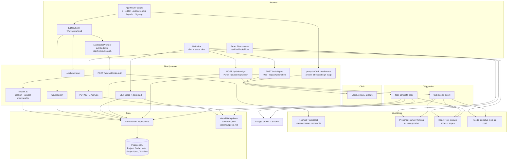

# Ghost AI – Complete System Architecture

## 1. Project Overview

Ghost AI (package name `gost-ai`, UI title “Ghost dev”) is a real-time collaborative system-design workspace. Authenticated users create projects, open a shared canvas (Liveblocks room id equals the project id), draw or import architecture graphs, prompt a background Gemini agent to mutate that graph, and generate a Markdown technical specification from the resulting nodes and edges.

**Core value proposition.** Turn a natural-language description and a shared diagram into a persisted architecture graph and a downloadable Markdown spec, with collaborators editing the same canvas at the same time.

**Target users / main use cases.** Signed-in designers or engineers who:

- Create and own architecture projects, or join one as a collaborator invited by email.
- Sketch systems on a React Flow canvas (shapes, colors, edges, starter templates).
- Ask “Ghost AI” to add, move, restyle, or connect nodes from a prompt.
- Generate, preview, and download a Markdown spec grounded in the current graph and optional design-chat history.

Out of scope in `context/project-overview.md`: billing, permission tiers beyond owner and collaborator, versioned spec review workflows, and native mobile apps. The overview still lists “production object storage migration” as out of scope; the implementation already stores canvas JSON and specs in private Vercel Blob (see sections 7 and 11).

## 2. Tech Stack

| Technology | Version (from `package.json`) | Role |
| --- | --- | --- |
| Next.js | `16.2.10` | App Router, React Server Components, route handlers under `app/api` |
| React / React DOM | `19.2.4` | UI runtime |
| TypeScript | `^5` | Typed app (`strict: true` in `tsconfig.json`, path alias `@/*`) |
| Tailwind CSS | `^4` (`@tailwindcss/postcss`) | Styling; tokens in `app/globals.css` |
| `tailwind-merge`, `clsx`, `class-variance-authority`, `tailwindcss-animate`, `tw-animate-css` | as declared | `cn()` in `lib/utils.ts` and shadcn-style variants |
| Radix UI | dialog, scroll-area, slot, tabs | Under `components/ui/*` |
| `lucide-react` | `^1.24.0` | Icons |
| `@xyflow/react` | `^12.11.2` | Canvas (React Flow) |
| Liveblocks | client / node / react / react-flow / react-ui `3.22.0` | Rooms, ID-token auth, presence, feeds, `useLiveblocksFlow` / server `mutateFlow` |
| Clerk | `@clerk/nextjs` `^7.5.16`, `@clerk/ui` `^1.25.3` | Auth, session, user lookup, dark theme |
| Prisma | `prisma` and `@prisma/client` `^7.8.0` | ORM; generated client at `app/generated/prisma` |
| `@prisma/adapter-pg` + `pg` | adapter `^7.8.0`, `pg` `^8.22.0` | Direct Postgres when `DATABASE_URL` is not Accelerate |
| `@prisma/extension-accelerate` | `^3.0.1` | Used when `DATABASE_URL` starts with `prisma+postgres://` |
| Trigger.dev | `@trigger.dev/sdk` and `@trigger.dev/react-hooks` `^4.5.4`, `@trigger.dev/build` (dev) | Background tasks and client `useRealtimeRun` |
| `@vercel/blob` | `^2.6.1` | Private canvas JSON and Markdown specs |
| Vercel AI SDK | `ai` `^7.0.30`, `@ai-sdk/google` `^4.0.17` | `generateObject` (design) and `generateText` (spec) against `gemini-2.5-flash` |
| Zod | `^4.4.3` | Spec request validation, chat feed schema, design-action schema |
| `react-markdown` | `^10.1.0` | Spec preview in `components/editor/specs-tab.tsx` |
| `dotenv` | `^17.4.2` | Loaded by `prisma.config.ts` |
| Geist / Geist Mono | `next/font/google` | Fonts in `app/layout.tsx` |
| ESLint | `eslint` `^9`, `eslint-config-next` `16.2.10` | `npm run lint` |

There is no separate state library (no Redux, Zustand, or React Context providers beyond Clerk and Liveblocks).

## 3. High-Level Architecture Diagram (Mermaid)



## 4. Folder & File Architecture

```
ghost-dev/
├── app/                         # Next.js App Router
│   ├── layout.tsx               # Root: ClerkProvider, Geist fonts, metadata
│   ├── page.tsx                 # / redirects to /editor or /sign-in
│   ├── globals.css              # Design tokens; hides #liveblocks-badge
│   ├── sign-in/                 # Clerk <SignIn /> + AuthLayout
│   ├── sign-up/                 # Clerk <SignUp /> + AuthLayout
│   ├── editor/page.tsx          # Project home (RSC)
│   ├── editor/[roomId]/page.tsx # Workspace (RSC access check)
│   ├── api/                     # Route handlers (see §6)
│   └── generated/prisma/        # Prisma client output (gitignored pattern typical)
├── components/
│   ├── auth/auth-layout.tsx     # Sign-in/up chrome
│   ├── editor/                  # Canvas, sidebars, dialogs, AI UI
│   └── ui/                      # button, card, dialog, input, scroll-area, tabs, textarea
├── hooks/                       # Client hooks (projects, share, autosave, shortcuts)
├── lib/
│   ├── auth.ts                  # Clerk user + membership
│   ├── prisma.ts                # Prisma singleton / Accelerate vs pg adapter
│   ├── projects.ts              # Owned + shared project queries
│   ├── project-access.ts        # Re-exports auth helpers
│   ├── liveblocks.ts            # Node client + cursor color hash
│   ├── mock-projects.ts         # slugify(); leftover mock lists unused by pages
│   └── utils.ts                 # cn()
├── types/canvas.ts              # Node/edge types, NODE_COLORS, NODE_SHAPES
├── types/tasks.ts               # Feed ids, Zod chat schema, status parsers
├── prisma/
│   ├── schema.prisma            # Generator + PostgreSQL datasource
│   ├── models/*.prisma          # Split models
│   └── migrations/              # Three SQL migrations
├── src/trigger/                 # design-agent.ts, generate-spec.ts
├── scripts/                     # test-project-spec.ts / .mjs (DB smoke)
├── context/                     # Product docs and feature specs 01–29
├── proxy.ts                     # Clerk middleware (Next 16 proxy convention)
├── liveblocks.config.ts         # Global Liveblocks type augmentation
├── trigger.config.ts            # Project ref, retries, dirs
├── prisma.config.ts             # Prisma 7 config (schema dir, DATABASE_URL)
├── next.config.js               # images.remotePatterns for img.clerk.com
└── README.md                    # Local setup
```

`context/architecture-context.md` mentions a `data/` directory as a legacy local artifact store. That directory is not present in the tree; new artifacts go to Vercel Blob.

## 5. Frontend Architecture

### 5.1 Pages & Routing

| Route | File | Kind | Behavior |
| --- | --- | --- | --- |
| `/` | `app/page.tsx` | RSC | `auth()`: authenticated → `/editor`, else → `/sign-in` |
| `/editor` | `app/editor/page.tsx` | RSC | `getCurrentUser()`; unauthenticated → `/sign-in`. Loads owned + shared projects into `EditorShell` |
| `/editor/[roomId]` | `app/editor/[roomId]/page.tsx` | RSC | Same auth. `getProjectWithAccess(roomId)`. Missing access still renders `WorkspaceShell` with `project={null}` (access-denied UI), not a redirect |
| `/sign-in/[[...sign-in]]` | `app/sign-in/.../page.tsx` | Client Clerk widget | Wrapped by `app/sign-in/layout.tsx` → `AuthLayout` |
| `/sign-up/[[...sign-up]]` | `app/sign-up/.../page.tsx` | Client Clerk widget | Same pattern, `signInHref="/sign-in"` |

**Layout hierarchy.** Only `app/layout.tsx` is a root layout (`ClerkProvider`, dark `@clerk/ui/themes`, CSS variables mapped to design tokens). Sign-in and sign-up add a nested layout. Editor routes do not have their own `layout.tsx`; shells are page-level.

**Protection.** `proxy.ts` uses `clerkMiddleware` and `createRouteMatcher`. Public: `/sign-in(.*)` and `/sign-up(.*)`. Every other matched path, including all `/api` routes, calls `auth.protect()`. The matcher skips `_next` and static files. Pages also re-check the session and redirect. API handlers call `getCurrentUser` / `getCurrentUserId` again and return 401 if missing.

There is no marketing landing page.

### 5.2 Components

**Auth**

- `components/auth/auth-layout.tsx` — shared frame around Clerk widgets.

**Editor home**

- `editor-shell.tsx` — client shell: sidebar collapsed by default, wires `useProjectActions`, create/rename/delete dialogs, `EditorHome`, `EditorNavbar`, `ProjectSidebar`.
- `editor-home.tsx` — empty-state / create CTA (`onCreateProject`).
- `editor-navbar.tsx` — home navbar (distinct from the workspace navbar defined inside `workspace-shell.tsx`).
- `project-sidebar.tsx` — owned vs shared lists, current room highlight, create, and owner-only rename/delete entry points.
- `create-project-dialog.tsx`, `rename-project-dialog.tsx`, `delete-project-dialog.tsx`, `dialog-pattern.tsx` — dialog chrome over `components/ui/dialog`.

**Workspace**

- `workspace-shell.tsx` — full-viewport layout. Local state: left sidebar open (default true), AI sidebar open (default false), templates modal, save status. If `project` is null, renders `AccessDenied` and an AI sidebar that is not room-connected. Otherwise wraps canvas and AI sidebar in one `LiveblocksRoom`.
- `access-denied.tsx` — shown when the room id is not a project the user can open.
- `share-dialog.tsx` — invite by email, list, remove, copy link. State from `useShareDialog`.

**Canvas (React Flow + Liveblocks)**

- `liveblocks-room.tsx` — `LiveblocksProvider` with `authEndpoint="/api/liveblocks-auth"`, `RoomProvider` `id={roomId}`, `initialPresence={{ cursor: null, thinking: false }}`, `ClientSideSuspense`.
- `canvas.tsx` — `Canvas` props: `roomId`, optional `templatesOpen` / `onTemplatesOpenChange`, `onSaveStatusChange`, `onSaveReady`. Wraps `ReactFlowProvider` and a class error boundary. Inner flow uses `useLiveblocksFlow` so nodes and edges live in Liveblocks storage. Registers node type `canvasNode` and edge type `canvasEdge`. Default edges are smooth custom edges with a closed arrow. Drop from the shape panel creates nodes. `CanvasLoading` is the room fallback.
- `canvas-node.tsx` — `CanvasNodeRenderer`: label edit, resize, four handles. Data: `label`, `color`, `shape` (`types/canvas.ts`).
- `node-shape-visual.tsx` — rectangle / pill / circle via CSS; diamond, hexagon, cylinder via SVG.
- `node-color-toolbar.tsx` — applies one of `NODE_COLORS` (eight fill/text pairs).
- `canvas-edge.tsx` — `CanvasEdgeRenderer`: smooth-step path, arrow, optional label.
- `shape-panel.tsx` — drag source; payload type `ShapeDragPayload`. Shapes: rectangle, diamond, circle, pill, cylinder, hexagon.
- `canvas-controls.tsx` — zoom and related controls; keyboard via `useKeyboardShortcuts` (`+`/`=` zoom in, `-` zoom out, Cmd/Ctrl+Z undo, Cmd/Ctrl+Shift+Z or Cmd/Ctrl+Y redo). Undo/redo come from Liveblocks flow history. Shortcuts ignore inputs and contenteditable.
- `starter-templates.ts` — static snapshots: `microservices`, `cicd-pipeline`, `event-driven`. `cloneTemplateWithFreshIds` rewrites ids before insert. Not stored in the database.
- `starter-templates-modal.tsx` — import into the live room (navbar “templates” and canvas-controlled open state).
- `presence-avatars.tsx` — other users’ name, avatar, color from Liveblocks `UserMeta`.
- `live-cursors.tsx` — `LiveCursors` plus `useCursorPresence`, which writes `presence.cursor` from pointer position. `thinking` is set by the design agent (user id `ghost-ai`), and the UI shows a spinner for that presence.

**AI**

- `ai-sidebar.tsx` — floating panel (Chat and Specs tabs). Props: `isOpen`, `onClose`, `roomConnected`, `roomId`, `projectId`. Starter prompts fill the textarea. On send (when the room is connected): posts to Liveblocks feed `ai-chat`, `POST /api/ai/design` with `{ prompt, roomId, projectId }`, then `POST /api/ai/design/token` with `{ runId }`, and subscribes with `useRealtimeRun`. Terminal Trigger statuses stop the subscription. An assistant chat message is posted when the run finishes.
- `ai-chat-feed.tsx` — `useAiChatFeed` / `useEnsureAiChatFeed`. Feed id `ai-chat`. Messages validated with `parseAiChatFeedPayload`. Roles: `user` | `assistant` | `system`.
- `ai-status-feed.tsx` — `useAiActivityState` / `useEnsureAiStatusFeed`. Feed id `ai-status-feed`. Phases: `start` | `processing` | `complete` | `error`.
- `specs-tab.tsx` — lists `GET /api/projects/:id/specs`. Generate: reads chat + current nodes/edges, `POST /api/ai/spec`, token route, `useRealtimeRun`. Preview fetches the download route (Markdown rendered with `react-markdown`). Download uses the same route’s `Content-Disposition`.

**UI primitives** (`components/ui/`): `button`, `card`, `dialog`, `input`, `scroll-area`, `tabs`, `textarea`. Project rules say not to restyle these for feature work.

### 5.3 Navigation & Layout Components

- Home (`/editor`): navbar + collapsible project sidebar + home canvas placeholder. Creating a project navigates to `/editor/{id}` (`useProjectActions` tracks `roomId` and the router).
- Workspace: fixed navbar (project name, sidebar toggle, templates, share, save, AI toggle) over a full-bleed canvas. Left `ProjectSidebar` switches rooms via navigation to `/editor/{projectId}`. Right AI sidebar is closed until toggled; on small screens it has a backdrop.
- Share copies a link to the current project room (client hook). Collaborator access is email membership in Postgres, not a secret share token.
- “Create project” from the workspace sidebar routes back to `/editor`.

### 5.4 Client-side State & Hooks

| Hook | File | Responsibility |
| --- | --- | --- |
| `useProjectActions` | `hooks/use-project-actions.ts` | Local copies of owned/shared lists; dialog state; `POST/PATCH/DELETE /api/projects` |
| `useShareDialog` | `hooks/use-share-dialog.ts` | Load/invite/remove collaborators; copy-link flag |
| `useCanvasLoad` | `hooks/use-canvas-load.ts` | If the Liveblocks room has no nodes and no edges, `GET` the canvas snapshot and call `onLoad`. If the room already has content, skip so collaboration is not overwritten |
| `useCanvasAutosave` | `hooks/use-canvas-autosave.ts` | Debounce 1500 ms (default). `PUT` `{ nodes, edges }`. Status `idle \| saving \| saved \| error`. `saveNow` for the navbar. Paused until load is ready |
| `useKeyboardShortcuts` | `hooks/useKeyboardShortcuts.ts` | Zoom and undo/redo |

**Liveblocks usage**

- Presence: `{ cursor: {x,y} \| null, thinking: boolean }`.
- User info (from ID token): `{ name, avatar, color }`. Color is a stable hash of the Clerk user id (`lib/liveblocks.ts`, eight-color palette).
- Storage: React Flow document via `@liveblocks/react-flow` (the type augmentation sets `Storage` to `Record<string, never>` because flow storage is owned by the React Flow integration, not custom LSON maps).
- Room events: optional legacy `AI_STATUS` event type is declared; the running path is feeds.
- Feeds: `ai-status-feed` and `ai-chat`. No Liveblocks comments/threads (`ThreadMetadata` is empty).
- No app-level React context besides these providers.

## 6. Backend / API Architecture

### 6.1 API Routes (Route Handlers)

All routes sit behind Clerk `auth.protect()` in `proxy.ts`. Handlers still check the user id.

| Route | Methods | Authz | Request | Response | Services |
| --- | --- | --- | --- | --- | --- |
| `/api/projects` | `GET` | Signed in | — | `{ projects, owned, shared }` (owned also aliased as `projects`) | Prisma via `getAllProjects` |
| `/api/projects` | `POST` | Signed in | Optional JSON `{ name }`. Empty/missing → `"Untitled Project"` | `201 { project }` | Prisma `project.create`. Best-effort `liveblocks.getOrCreateRoom(id)` with owner `room:write`. Room failure is logged, create still succeeds |
| `/api/projects/[projectId]` | `PATCH` | Owner only | `{ name }` required non-empty | `{ project }` or 400/403/404 | Prisma update |
| `/api/projects/[projectId]` | `DELETE` | Owner only | — | `204` | Prisma delete (cascades collaborators and specs). Best-effort `liveblocks.deleteRoom` |
| `/api/projects/[projectId]/canvas` | `PUT` | Owner or collaborator | `{ nodes: array, edges: array }` | `{ canvasJsonPath, updatedAt }` | `@vercel/blob` `put` private `canvas/{projectId}.json` (`allowOverwrite`, no random suffix). Prisma stores blob URL on `canvasJsonPath` |
| `/api/projects/[projectId]/canvas` | `GET` | Owner or collaborator | — | `{ nodes, edges, canvasJsonPath }` or empty arrays if unset. Blob failures `502` | Prisma then `get` private blob |
| `/api/projects/[projectId]/collaborators` | `GET` | Owner or collaborator | — | `{ collaborators }` with ISO `createdAt`, Clerk `name`, `avatarUrl` | Prisma + `getClerkUsersByEmails` |
| `/api/projects/[projectId]/collaborators` | `POST` | Owner only | `{ email }` regex-validated, stored lowercased | `201 { collaborator }` or `409` if duplicate, `400` if inviting the owner | Prisma. If invitee has a Clerk user, best-effort room write access |
| `/api/projects/[projectId]/collaborators/[collaboratorId]` | `DELETE` | Owner only | — | `204` | Prisma delete. Best-effort `updateRoom` with `usersAccesses[userId]=null` |
| `/api/projects/[projectId]/specs` | `GET` | Owner or collaborator | — | `{ specs: [{ id, createdAt, filename }] }`. Excludes `filePath === "pending"`. No blob URLs | Prisma |
| `/api/projects/[projectId]/specs/[specId]/download` | `GET` | Owner or collaborator; spec must belong to project | — | Markdown body, `Content-Disposition: attachment; filename="spec-{id}.md"`. Pending or missing `404`. Blob errors `502` | Prisma + private blob `get` |
| `/api/liveblocks-auth` | `POST` | Signed in; must be member of `room` | Liveblocks body `{ room }` | ID-token body from `liveblocks.identifyUser` (status forwarded). `400` if room missing, `403` if no membership | Clerk profile, `getOrCreateRoom` + `updateRoom` `room:write`, `createFeed` for both feeds |
| `/api/ai/design` | `POST` | Member of `projectId` | `{ prompt, roomId, projectId }` all non-empty; **roomId must equal projectId** | `{ runId }` | `tasks.trigger("design-agent", { prompt, roomId })`. Inserts `TaskRun` |
| `/api/ai/design/token` | `POST` | `TaskRun.userId` must be caller | `{ runId }` | `{ token }` public token, scope `read.runs: [runId]`, `expirationTime: "1hr"` | Prisma + Trigger `auth.createPublicToken` |
| `/api/ai/spec` | `POST` | Member of `roomId` (treated as project id; no client `projectId`) | Zod: `{ roomId, chatHistory[], nodes[], edges[] }` | `{ runId }` | `tasks.trigger("generate-spec", …)` + `TaskRun` |
| `/api/ai/spec/token` | `POST` | Same TaskRun ownership | `{ runId }` | `{ token }` same 1-hour read scope | Prisma + Trigger |

Null from `getProjectWithAccess` is split into 401 vs 403 on canvas routes by a second `getCurrentUserId` check. Collaborator GET distinguishes 404 (no row) vs 403. Liveblocks auth returns 403 for both missing project and non-member.

### 6.2 Controllers / Service Layer

There is no separate controller package. Business logic lives in:

- `lib/auth.ts` — session, primary email (lowercased), `getProjectWithAccess` (owner by Clerk user id, else collaborator by email; never throws), Clerk user lookups.
- `lib/projects.ts` — `getOwnedProjects`, `getSharedProjects`, `getAllProjects`.
- `lib/prisma.ts` — client factory.
- `lib/liveblocks.ts` — secret client and `getUserColor`.
- Route files — validation and orchestration.
- `src/trigger/*` — AI and blob persistence.

### 6.3 Authentication & Authorization

1. **Edge/proxy:** `proxy.ts` (`clerkMiddleware`). This file is the middleware entry (Next.js 16 `proxy` convention). It is not named `middleware.ts`.
2. **Session helpers:** `auth()` and `clerkClient()` from `@clerk/nextjs/server`.
3. **Project ACL:** one owner (`Project.ownerId` = Clerk user id). Extra editors are `ProjectCollaborator` rows keyed by lowercased email, unique per `(projectId, email)`. Collaborators and owners can read and mutate canvas, list specs, download specs, and trigger AI. Only the owner can rename, delete, invite, and remove collaborators.
4. **Liveblocks ACL:** rooms are private (`defaultAccesses: []`). Verified members receive `room:write` on auth and, when resolvable, on invite. Removal nulls that user’s access. Postgres membership is treated as source of truth; Liveblocks updates are best-effort except on the auth route, where room prep failure returns 500.
5. **Trigger tokens:** only the user who started the run (`TaskRun.userId`) can mint a read token. Tokens are not project-wide.

`ProjectStatus` (`DRAFT` | `ARCHIVED`) exists in the schema with default `DRAFT` but no route sets `ARCHIVED`.

## 7. Database Schema (Prisma)

Generator: `prisma-client` → `../app/generated/prisma`. Datasource provider `postgresql`. URL is not in the schema file; `prisma.config.ts` sets `datasource.url` from `DATABASE_URL`. Models are split across `prisma/models/` and composed because `schema: "prisma/"`.

### `Project` (`projects`)

| Field | Notes |
| --- | --- |
| `id` | `cuid`, also the Liveblocks room id |
| `ownerId` | Clerk user id, indexed |
| `name` | string |
| `description` | optional, unused by current APIs |
| `status` | `ProjectStatus`, default `DRAFT` |
| `canvasJsonPath` | private blob URL, nullable |
| `createdAt` / `updatedAt` | `createdAt` indexed |

Relations: `collaborators`, `specs` (cascade delete).

### `ProjectCollaborator` (`project_collaborators`)

| Field | Notes |
| --- | --- |
| `id` | cuid |
| `projectId` | FK, cascade |
| `email` | lowercased by API |
| `createdAt` | |

Constraints: `@@unique([projectId, email])`, indexes on `email` and `[projectId, createdAt]`.

### `ProjectSpec` (`project_specs`)

Metadata only. Markdown is in Blob.

| Field | Notes |
| --- | --- |
| `id` | cuid, used in pathname and download filename |
| `projectId` | FK, cascade |
| `filePath` | blob URL, or the literal `"pending"` while upload is in flight |
| `createdAt` | |

Indexes: `projectId`, `[projectId, createdAt]`.

### `TaskRun` (`task_runs`)

Not a Prisma relation to `Project` (no FK).

| Field | Notes |
| --- | --- |
| `id` | cuid |
| `runId` | unique Trigger.dev run id |
| `projectId` | string |
| `userId` | Clerk user who triggered the run |
| `createdAt` | |

Indexes: `runId`, `[userId, projectId]`.

**Migrations:** `20260715063438_init_project_models`, `20260717071001_add_task_run_model`, `20260717091248_add_project_spec_model`.

**Product mapping.** A “room” is not a table. The project id is the room id. Canvas content is Liveblocks storage plus an optional blob snapshot. Specs are rows plus blobs. Users are Clerk identities, not a local `User` model.

## 8. Background Jobs & AI Workflows (Trigger.dev)

Config: `trigger.config.ts`. Project `proj_fpwrigxqxqciobpumahp`, runtime `node`, `maxDuration` 3600 seconds, dirs `./src/trigger`. Default retries: 3 attempts, 1s–10s backoff, factor 2, jitter, enabled in dev. Both tasks override `retry.maxAttempts` to **1**.

### `design-agent` (`src/trigger/design-agent.ts`)

- **Trigger:** `POST /api/ai/design` → `tasks.trigger("design-agent", { prompt, roomId })`.
- **Input:** `{ prompt: string, roomId: string }`.
- **Steps:** publish `ai-status-feed` “start”; set presence for user `ghost-ai` (`thinking: true`, cursor, TTL 120s); `mutateFlow` read of current nodes/edges; `generateObject` with Zod plan (max 80 actions); apply actions in one `mutateFlow` (add/move/resize/update/delete node, add/delete edge) with short sleeps and cursor updates; status “complete”; clear presence (TTL 2s). Errors publish phase `error` and clear presence.
- **Model:** `createGoogleGenerativeAI` + `gemini-2.5-flash`. Key: `GOOGLE_AI_API_KEY` or `GOOGLE_GENERATIVE_AI_API_KEY`.
- **Output:** `{ ok: true, prompt, roomId, actionCount, summary }`.
- **Does not** write Postgres or Blob. Canvas persistence is the client autosave.

Actions are discriminated: `addNode`, `moveNode`, `resizeNode`, `updateNodeData`, `deleteNode`, `addEdge`, `deleteEdge`. Layout constants space new nodes (column gap 240, row gap 140).

### `generate-spec` (`src/trigger/generate-spec.ts`)

- **Trigger:** `POST /api/ai/spec`.
- **Input:** `{ projectId, roomId, chatHistory, nodes, edges }` (Zod, including inside the task).
- **Steps:** run `metadata` (`status`, `message`, `kind: "spec"`, ids). Prefer live `mutateFlow` snapshot when the room has nodes; else the client snapshot. Empty graph throws. Compact graph + chat, `generateText` (`gemini-2.5-flash`) for Markdown only. `persistSpecMarkdown`: create `ProjectSpec` with `filePath: "pending"`, `put` private `specs/{projectId}/{specId}.md`, update `filePath` to the blob URL. Upload failure deletes the pending row.
- **Output:** `{ ok, projectId, roomId, specId, filePath, content }`. `filePath` is the blob URL stored in the DB; the list/download APIs do not return it to the browser.
- **Progress to the client:** Trigger run metadata (sidebar `useRealtimeRun`), not the Liveblocks status feed.

Local worker: `npx trigger.dev@latest dev` (README). Hosting uses `npx trigger.dev@latest deploy` and a production `TRIGGER_SECRET_KEY`.

## 9. Real-time Collaboration (Liveblocks)

**Room structure.** One room per project. Id = `Project.id`. No groups (`groupIds: []` on identify). Default access empty; explicit `room:write` per Clerk user id.

**Presence.** Cursor coordinates and a `thinking` flag. Human clients update the cursor (`useCursorPresence`). The design task writes a synthetic user `ghost-ai` (name/color accent `#6457f9`) through the Node SDK.

**Storage / sync.** `@liveblocks/react-flow` `useLiveblocksFlow` on the client and `mutateFlow` on the server. Conflict handling is Liveblocks’ CRDT storage for the flow document, not an app-level merge. The client does not last-write-wins the blob over a non-empty room: blob hydration runs only when both node and edge arrays are empty (`use-canvas-load.ts`). Autosave then snapshots the live graph to Blob so a later empty-room visit can restore it. Two simultaneous editors therefore sync through Liveblocks, not through the blob.

**Feeds.** Created on auth (`ensureRoomFeed`) and again from the client (`useCreateFeed`). Status messages are validated before render. Chat and status are separate feeds (invariant in `context/progress-tracker.md`).

**Legacy.** `RoomEvent` type `AI_STATUS` is declared in `liveblocks.config.ts` and documented as legacy. Design status uses the feed.

**Undo.** Liveblocks flow history, exposed as undo/redo to keyboard shortcuts.

## 10. Data Flow & Key Workflows

### 1. User signs in → lands on editor

1. Unauthenticated `/` or any non-public route hits `proxy.ts` → Clerk sign-in.
2. `NEXT_PUBLIC_CLERK_SIGN_IN_FORCE_REDIRECT_URL` and the sign-up equivalent are `/editor` (README).
3. `/` sees `isAuthenticated` and redirects to `/editor`.
4. `EditorPage` loads `getCurrentUser()` (Clerk user + primary email) and `getAllProjects`.
5. `EditorShell` renders lists. Sidebar starts closed.

### 2. Creating / joining a design room

1. Create dialog → `POST /api/projects` → Prisma row + best-effort room.
2. Client navigates to `/editor/{projectId}`.
3. RSC checks membership. Owner passes.
4. `LiveblocksRoom` POSTs `/api/liveblocks-auth` with `{ room }`.
5. Server confirms membership, ensures room write access and both feeds, returns an ID token with name, avatar, and cursor color.
6. Join as collaborator: owner `POST .../collaborators` with email. Invitee must sign in with that email. Opening `/editor/{projectId}` passes `getProjectWithAccess`. Auth grants `room:write` even if the invite-time Clerk lookup failed.
7. Non-members see `AccessDenied` inside the same URL.

### 3. Prompting the AI agent on the canvas

1. User opens the AI sidebar and sends text (or a starter prompt).
2. The message is appended to feed `ai-chat` (role `user`).
3. `POST /api/ai/design` checks `roomId === projectId` and membership, triggers `design-agent`, stores `TaskRun`.
4. Client fetches a one-hour read token and subscribes with `useRealtimeRun`.
5. The task reads the room, asks Gemini for a Zod action list, and applies it with `mutateFlow` while broadcasting status-feed lines and `ghost-ai` presence.
6. All connected clients see nodes change through Liveblocks. Autosave later PUTs the graph to Blob.
7. On completion the sidebar posts an assistant line to `ai-chat`. Failures surface as status phase `error` and a chat error path in the sidebar.

### 4. Collaborative editing of the diagram

1. Shape panel drag-drop, node label/resize/color, edge connect/label, template import, and keyboard undo all go through React Flow operations stored by `useLiveblocksFlow`.
2. Other clients render the same storage. Avatars and cursors use presence and user info.
3. Templates replace/insert by cloning static nodes with fresh ids into the room (`starter-templates.ts`). They do not create projects.

### 5. Generating Markdown specs

1. Specs tab (room connected) sends `POST /api/ai/spec` with `roomId`, `chatHistory` from `ai-chat`, and current `nodes`/`edges`.
2. Server authorizes via `roomId`, triggers `generate-spec`, stores `TaskRun`, returns `runId`.
3. Client subscribes with a read token from `/api/ai/spec/token`. UI follows run metadata.
4. Task prefers the live room graph, calls Gemini, uploads Markdown, writes `ProjectSpec`.
5. Sidebar refetches `GET /api/projects/{id}/specs` (metadata only).

### 6. Saving / loading canvas snapshots

1. After hydration is ready, graph changes debounce 1500 ms to `PUT /api/projects/{id}/canvas`.
2. Navbar Save calls `saveNow` (immediate PUT).
3. Blob path `canvas/{projectId}.json`, private, overwrite allowed. URL saved on `Project.canvasJsonPath`.
4. Next visit: if Liveblocks storage is empty, `GET` loads that JSON into the room. If anyone is already in a non-empty room, the blob is ignored.

### 7. Other journeys

- **Rename / delete:** owner-only PATCH/DELETE. Delete removes the DB row (cascade specs and collaborators) and best-effort deletes the Liveblocks room. Blob objects are not deleted in code.
- **Preview spec:** download route returns Markdown; the dialog renders it. The same response is an attachment download. Private blob URLs are not sent to the client.
- **Sign out:** Clerk; `NEXT_PUBLIC_CLERK_AFTER_SIGN_OUT_URL=/` then `/` sends the user to `/sign-in`.

## 11. External Integrations

| System | Credentials | Code that talks to it | Failure handling in code |
| --- | --- | --- | --- |
| Clerk | `NEXT_PUBLIC_CLERK_PUBLISHABLE_KEY`, `CLERK_SECRET_KEY`, URL env vars (README). SDK reads them; app code does not reference `process.env` for Clerk | `proxy.ts`, `app/layout.tsx`, `app/page.tsx`, `lib/auth.ts`, collaborator routes, Liveblocks auth | `getProjectWithAccess` catches and returns null. Liveblocks auth falls back to email / `"Collaborator"` if profile lookup fails. Middleware blocks unsigned users |
| Liveblocks | `LIVEBLOCKS_SECRET_KEY` in `lib/liveblocks.ts` (empty string if unset). `LIVEBLOCKS_PUBLIC_KEY` is listed in the README only; no source reference | `lib/liveblocks.ts`, auth route, project create/delete, collaborator grant/revoke, both trigger tasks | Create-room and delete-room failures are logged and do not fail the HTTP mutation, except auth where room ensure failure is HTTP 500. Feed create errors are swallowed (already exists). Canvas error boundary catches client room errors |
| Trigger.dev | `TRIGGER_SECRET_KEY` (SDK). README: `tr_dev_...` locally, `tr_prod_...` only in production plus `trigger.dev deploy` | API design/spec routes, token routes, `useRealtimeRun` in `ai-sidebar.tsx` and `specs-tab.tsx` | Route catch → 500 JSON. Tasks set `maxAttempts: 1`. Spec task sets metadata `status=error`. Design task publishes a feed error |
| Vercel Blob | `BLOB_READ_WRITE_TOKEN` (SDK default; not named in app source) | Canvas route `put`/`get`; `generate-spec.ts` `put`; spec download `get` | Canvas/spec download: `502` if blob read fails. Spec task deletes the pending Prisma row if upload throws |
| Google AI (Gemini) | `GOOGLE_AI_API_KEY` or `GOOGLE_GENERATIVE_AI_API_KEY` inside both tasks | `src/trigger/design-agent.ts` (`generateObject`), `src/trigger/generate-spec.ts` (`generateText`), model id `gemini-2.5-flash` | Missing key throws a clear error, which both tasks surface as failed runs |
| PostgreSQL | `DATABASE_URL` | `lib/prisma.ts`, `prisma.config.ts`. `prisma+postgres://` → Accelerate + `withAccelerate()`. Other URLs → `PrismaPg` | Missing URL throws at client creation. Dev singleton drops itself if the `projectSpec` delegate is missing after generate |

`next.config.js` allows `images` from `https://img.clerk.com`.

## 12. Environment Variables & Configuration

| Variable | Where it is used | Purpose |
| --- | --- | --- |
| `DATABASE_URL` | `lib/prisma.ts`, `prisma.config.ts`, `scripts/test-project-spec.mjs` | Postgres or Prisma Accelerate URL |
| `NEXT_PUBLIC_CLERK_PUBLISHABLE_KEY` | Clerk SDK (documented in README) | Browser Clerk |
| `CLERK_SECRET_KEY` | Clerk SDK (README) | Server Clerk |
| `NEXT_PUBLIC_CLERK_SIGN_IN_URL` | README: `/sign-in` | Clerk route |
| `NEXT_PUBLIC_CLERK_SIGN_UP_URL` | README: `/sign-up` | Clerk route |
| `NEXT_PUBLIC_CLERK_SIGN_IN_FORCE_REDIRECT_URL` | README: `/editor` | Post sign-in |
| `NEXT_PUBLIC_CLERK_SIGN_UP_FORCE_REDIRECT_URL` | README: `/editor` | Post sign-up |
| `NEXT_PUBLIC_CLERK_AFTER_SIGN_OUT_URL` | README: `/` | Post sign-out |
| `LIVEBLOCKS_SECRET_KEY` | `lib/liveblocks.ts` | Node Liveblocks secret |
| `LIVEBLOCKS_PUBLIC_KEY` | README only | Not read by application source |
| `TRIGGER_SECRET_KEY` | Trigger SDK (README) | Trigger API auth |
| `BLOB_READ_WRITE_TOKEN` | `@vercel/blob` (README) | Blob read/write |
| `GOOGLE_AI_API_KEY` | Both tasks | Gemini |
| `GOOGLE_GENERATIVE_AI_API_KEY` | Both tasks, fallback | Gemini alternate name |
| `NODE_ENV` | `lib/prisma.ts`, `lib/liveblocks.ts` | Dev global caches |

No `.env.example` file is in the repo. README says put keys in `.env.local`, and `DATABASE_URL` in `.env` if the Prisma CLI needs it. `prisma.config.ts` loads `dotenv/config`.

`trigger.config.ts` hardcodes the Trigger project ref `proj_fpwrigxqxqciobpumahp`.

## 13. Security Considerations

- **Auth boundary:** Clerk middleware on pages and `/api/*`. Public only sign-in and sign-up. No anonymous room access.
- **Authorization:** Mutations check owner or collaborator in the handler. Rename, delete, invite, and remove are owner-only. AI routes bind the task to the authorized project id. Spec generation does not accept a separate client project id.
- **ID token:** Liveblocks identify runs only after membership check. User info is name, avatar, color — not email in the token payload (email is used server-side for the display name fallback).
- **Blob:** `access: "private"`. Download and canvas GET stream bytes through the app after an access check. Spec list omits `filePath`.
- **Trigger public tokens:** Read scope for a single run, one hour, only if `TaskRun.userId` matches. They do not grant task triggers.
- **Validation:** Canvas PUT requires both arrays (elements are cast, not deeply schema-checked). Collaborator email uses a simple regex. Spec trigger and spec token use Zod. Design actions are Zod-constrained inside the task (max 80). Chat feed messages are Zod-parsed before render. Status feed payloads are manually parsed.
- **Secrets:** Server keys are read from the environment. The Liveblocks secret defaults to `""` if missing, which fails later at the API rather than at boot.
- **Rate limiting:** None in application code.
- **Branding:** `unsafe_disableDevelopmentModeWarnings: true` and hidden Clerk footer in `app/layout.tsx`. `#liveblocks-badge` hidden in CSS. These are UI flags, not access control.
- **Cascade delete** removes spec metadata but not blob objects or `TaskRun` rows (`TaskRun` has no FK).

## 14. Deployment & Runtime Notes

**Local (README):**

- Node.js 20+, PostgreSQL, accounts for Clerk, Liveblocks, Trigger.dev, Vercel Blob, Google AI.
- `npm install` — the `install` script runs `prisma generate` (README text says `postinstall`; `package.json` defines `"install": "prisma generate"`).
- `npx prisma migrate dev`.
- Terminal A: `npm run dev` (Next dev). Terminal B: `npx trigger.dev@latest dev`.
- App: `http://localhost:3000`.

**Scripts:** `dev`, `build` (`next build`), `start` (`next start`), `lint` (`eslint`).

**Production signals in repo:**

- README: production host should use `tr_prod_...` as `TRIGGER_SECRET_KEY` and `npx trigger.dev@latest deploy`. A prod key in `.env.local` sends runs to production with no local worker (“Pending version”).
- `next start` / `next build` imply a Node host (Vercel-style). Blob and Clerk image host fit that, but there is no `vercel.json`.
- Trigger `maxDuration` 3600s is for the worker, not the Next.js route. Routes only enqueue.
- Prisma Accelerate is optional via URL scheme; otherwise a direct `pg` pool.
- `lib/prisma.ts` dev cache key `projectSpec:v1` exists so HMR does not keep a client from before `ProjectSpec` was generated.

`scripts/test-project-spec.ts` and `.mjs` are database smoke scripts, not part of `npm` scripts.

## 15. Known Limitations / Technical Debt

Visible in code, comments, or context docs — not inferred product ideas:

- `context/architecture-context.md` and `context/project-overview.md` still say canvas snapshots are “persisted to the filesystem” and that spec output is “saved to the filesystem”, and they list production object storage as out of scope. The code uses private Vercel Blob and stores URLs on `canvasJsonPath` and `ProjectSpec.filePath`. The progress tracker matches the code.
- `context/architecture-context.md` refers to a legacy `data/` directory. It is not in the tree.
- `Project.description` and `ProjectStatus.ARCHIVED` are unused by APIs. Every created project stays `DRAFT`.
- `TaskRun` is not foreign-keyed to `Project` and is not deleted with the project.
- Deleting a project does not delete Blob objects.
- `lib/mock-projects.ts` still exports `initialOwnedProjects` / `initialSharedProjects` (“while persistence is not yet wired”). Pages only use `slugify` from that file. Slugs are UI-only; routes use the cuid.
- Liveblocks room cleanup on delete, invite, and remove is best-effort. A failed revoke can leave `room:write` until the next auth check refuses a token for non-members — auth still requires a collaborator row, so a stale Liveblocks ACL alone does not pass the app’s auth route.
- Canvas PUT does not validate each node’s `data` shape.
- No application rate limits on AI triggers or invites.
- `LIVEBLOCKS_PUBLIC_KEY` is documented but unused.
- Design-agent room events typed as `AI_STATUS` are marked legacy; clients use feeds.
- `context/progress-tracker.md`: features 01–29 are done; feature 30 is TBD; open questions: none.
- `context/current-issues-liveblocks-canvas.md`: “NONE”.
- README says `postinstall` runs Prisma generate; the script key is `install`.
- Package name is `gost-ai` (typo relative to the product name Ghost AI).
